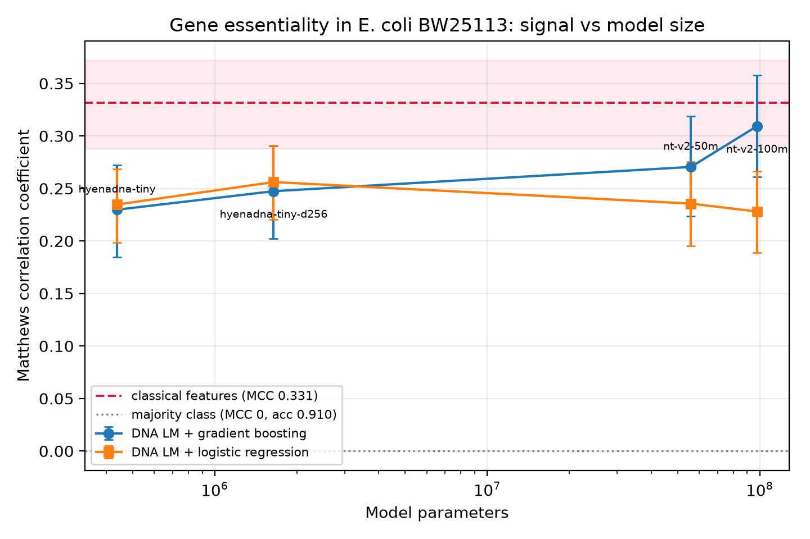

# small-dna-lm-essentiality

**How small can a DNA language model be and still predict bacterial gene essentiality?**

DNA language models are growing quickly, but gene essentiality is a coarse
property. How much model do you actually need? This repository compares four
DNA language models, from 438 thousand to 98 million parameters, against a
classical sequence-feature baseline, on identical cross-validation folds. All
of it runs on a laptop CPU.

## Result

**None of the four language models beat cheap sequence features.**

| Representation | Parameters | MCC (E. coli) | MCC (B. subtilis, no retraining) |
|---|---|---|---|
| **Classical features** | — | **0.331** | **0.198** |
| NT v2 100M | 97,889,132 | 0.309 | 0.190 |
| NT v2 50M | 55,904,972 | 0.271 | 0.144 |
| HyenaDNA tiny-d256 | 1,645,184 | 0.256 | 0.003 |
| HyenaDNA tiny | 438,144 | 0.235 | −0.019 |

Matthews correlation coefficient; 0 is chance. Accuracy is not reported alone,
because the classes are imbalanced (1:10) and predicting "non-essential" for
every gene already scores 91%.

Three findings:

1. **No language model beat the baseline.** In paired bootstrap comparisons on
   identical genes, 7 of 8 model-classifier combinations were *significantly
   worse* than classical features, and none was better. The largest model only
   draws level.
2. **Scaling is weak and not consistent in direction.** Across a 223-fold
   increase in parameters, MCC rises 0.230 → 0.309 with gradient boosting but
   *falls* 0.235 → 0.228 with logistic regression.
3. **Only the larger models transfer at all.** Applied to *B. subtilis* without
   retraining, everything degrades, but the small models collapse to chance
   (MCC −0.019). They had fitted *E. coli*'s composition, not essentiality.

The leakage control matters here: gene length alone gives MCC 0.041, so a
positive result cannot be dismissed as "it learned gene length". One model's
embedding norms nevertheless correlate strongly with length (NT v2 50M,
r = +0.79), which is worth knowing about that representation.



## Reproduce it

```bash
python -m venv .venv && .venv/Scripts/pip install -r requirements.txt
python run_all.py           # about 2 hours on a laptop CPU
python run_all.py --quick   # a few minutes, smoke test only
```

Stages are skipped when their outputs exist, so an interrupted run resumes.
Every number in `results/` and in `paper/manuscript.md` is produced by a script
in `scripts/`; nothing is typed by hand.

Requires **x64 Python 3.11**. `transformers` is pinned to 4.x because the
Nucleotide Transformer remote code does not import on 5.x.

## Data

| | Source |
|---|---|
| E. coli genome | `CP009273.1`, strain **BW25113** |
| E. coli labels | Goodall et al. 2018, mBio 9:e02096-17, Table S1 (TraDIS) |
| B. subtilis genome | `NC_000964.3`, strain 168 |
| B. subtilis labels | SubtiWiki v5 |

BW25113 rather than the more familiar MG1655 because Goodall et al. assayed
BW25113 and mapped their reads to that assembly; against MG1655, 15 measured
genes cannot be located at all. ECK identifiers, present in both annotations,
carry b-numbers across for 99.5% of genes.

The two Goodall supplementary spreadsheets are committed to `data/raw/`
because PMC blocks automated downloads and the publisher sits behind a bot
check, so a fresh clone cannot fetch them.

## Layout

```
src/           features, embeddings, model registry, the canonical CV split
scripts/       one stage each; run in the order run_all.py uses
tests/         27 tests, including fold stability and embedding determinism
results/       committed CSV/JSON for every number, plus figures
paper/         manuscript.md, generated from results/
```

## Limitations

Two organisms only. Frozen embeddings with a shallow classifier is not
fine-tuning. Four models is not a scaling law, and architecture is confounded
with scale. Nucleotide Transformer very likely saw these genomes in
pretraining. Essentiality labels are medium-dependent and noisy. See
`paper/manuscript.md` section 5.

## License

MIT.
